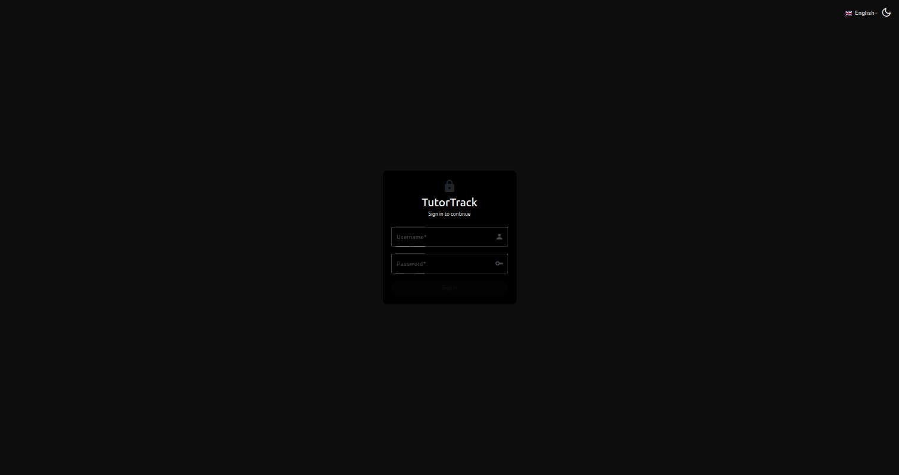
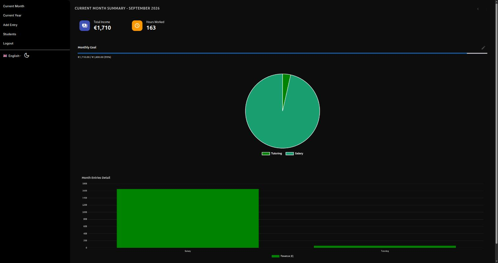
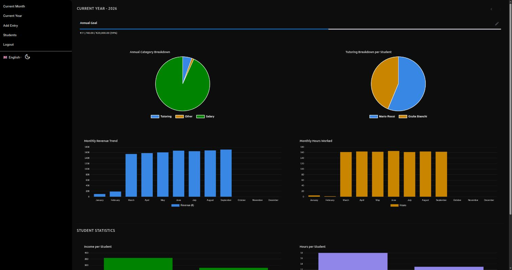
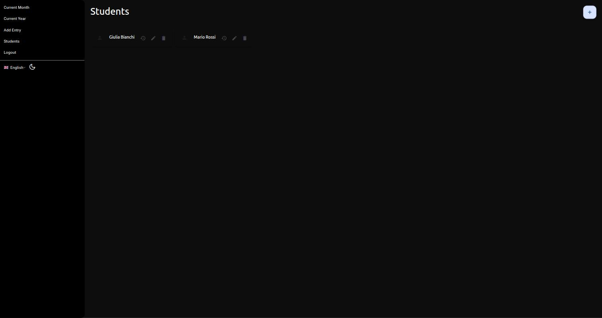
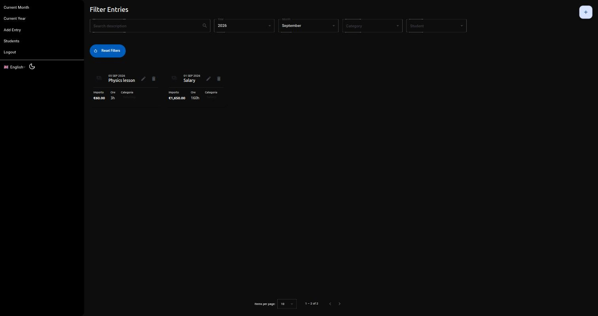

# TutorTrack

A full-stack income tracker built for private tutors, freelancers, and anyone with mixed income streams. Log entries, tag them by category and student, and track progress against monthly and annual goals — with a dashboard that turns it all into charts.

This is a personal project I use to track my own tutoring income. It's shared here as a portfolio piece showing an end-to-end full-stack setup: a .NET Web API backed by EF Core / SQLite, and an Angular frontend, containerized with Docker.

## Screenshots

| | |
|---|---|
|  |  |
| Login | Current month dashboard |
|  |  |
| Yearly overview | Students |
|  | |
| Filterable entries list | |

> Data shown above is seeded demo data, not real financial information.

## Features

- **Income entries** — create, edit, delete, and filter entries by description, year, month, category, and student
- **Categories** — Tutoring, Salary, Other, each with translated labels (Italian/English)
- **Students** — optional link between a tutoring entry and a student, with per-student income/hours stats
- **Goals** — set a monthly and an annual income target and track progress
- **Dashboards** — current month and current year views with category breakdowns, monthly trends, and hours worked, powered by Chart.js
- **Auth** — single-user JWT login (no public sign-up, this is a personal-use app)
- **i18n & theme** — Italian/English UI, light/dark theme
- **Dockerized** — one `docker compose up` builds and runs both frontend and backend behind a single container

## Tech stack

**Backend** (`TutorTrackApi/`)
- ASP.NET Core 8 Web API
- Entity Framework Core 8 + SQLite
- JWT Bearer authentication, PBKDF2 password hashing
- Swagger (development only)

**Frontend** (`TutorTrackAngular/`)
- Angular 21 (standalone components)
- Angular Material / ng-bootstrap
- ngx-translate for i18n
- ng2-charts (Chart.js)

## Project structure

```
TutorTrack/
├── TutorTrackApi/        # ASP.NET Core Web API
│   ├── Controllers/
│   ├── Services/
│   ├── Repositories/
│   ├── Models/            # EF Core entities + AppDbContext
│   ├── Migrations/        # EF Core migrations
│   └── Dtos/
├── TutorTrackAngular/     # Angular SPA
│   └── src/app/
│       ├── pages/
│       ├── components/
│       └── services/
├── Dockerfile             # multi-stage build: Angular -> .NET -> runtime
├── docker-compose.yml
└── .env.example
```

In production, the API serves the built Angular app as static files from `wwwroot`, so the whole thing runs as a single container/process.

## Getting started

### Option A — Docker (recommended)

Requires Docker and Docker Compose.

```bash
cp .env.example .env
# edit .env: set JWT_KEY (e.g. `openssl rand -base64 48`), AUTH_USERNAME, AUTH_PASSWORD
docker compose up --build
```

The app will be available at `http://localhost:8080`. On first boot it runs pending EF Core migrations automatically and seeds a single user from `AUTH_USERNAME` / `AUTH_PASSWORD`. The SQLite database lives in a named Docker volume (`tutortrack-data`), so it persists across container restarts.

### Option B — Local development

Requires the .NET 8 SDK and Node.js 20+.

**Backend**

```bash
cd TutorTrackApi

# Store secrets outside of source control (dotnet user-secrets)
dotnet user-secrets set "Jwt:Key" "$(openssl rand -base64 48)"
dotnet user-secrets set "Jwt:Issuer" "TutorTrackApi"
dotnet user-secrets set "Jwt:Audience" "TutorTrackAngular"
dotnet user-secrets set "Auth:Username" "your-username"
dotnet user-secrets set "Auth:Password" "your-password"

dotnet run
```

The API starts on `http://localhost:5273`. On startup it:
1. Applies any pending EF Core migrations (`db.Database.MigrateAsync()`), creating `tutortrack.db` if it doesn't exist yet.
2. Seeds one user from `Auth:Username` / `Auth:Password`, but only if the `Users` table is empty — it won't touch an existing account.

**Frontend**

```bash
cd TutorTrackAngular
npm install
ng serve
```

Open `http://localhost:4200`. The dev build calls the API at `http://localhost:5273/api` (see `src/environments/environment.ts`), and CORS on the API side already allows `http://localhost:4200`.

### Database migrations

Migrations live in `TutorTrackApi/Migrations/` and are applied automatically at startup — no manual `dotnet ef database update` step is needed to run the app.

To add a new migration after changing an entity or `AppDbContext`:

```bash
cd TutorTrackApi
dotnet ef migrations add <MigrationName>
```

This requires the `dotnet-ef` tool (`dotnet tool install --global dotnet-ef` if you don't have it) and the `Microsoft.EntityFrameworkCore.Design` package (already referenced in the project).

## License

MIT — see [LICENSE](LICENSE).
